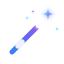

# Gemini Removal ✦

<p align="center">
  
</p>

<p align="center">
  <strong>Fast, private, client-side watermark remover for Gemini AI images & videos.</strong><br>
  <em>No server uploads, no sign-up required — 100% local browser processing.</em>
</p>

<p align="center">
  <a href="https://github.com/pushpajit-dev/GeminiRemoval/stargazers"></a>
  <a href="LICENSE"></a>
  
  
</p>

---

## 🌟 Key Highlights

- **🖼️ Image Removal**: Instant mathematical reverse alpha blending for Gemini image watermarks and logos (PNG, JPG, WebP) with interactive before/after comparison slider.
- **🎥 Video Removal**: Client-side video frame decoding, neural residual cleaning, and MP4 remuxing using modern WebCodecs and WebAssembly with synchronized dual video preview.
- **⚡ Discord-Style Quick Selector**: Switch effortlessly between Image and Video tools using a smooth Discord-inspired squircle sidebar rail.
- **🔒 Zero Server Uploads**: Every byte is decoded, processed, and encoded directly on your machine. Your media never touches an external server.
- **📱 Android & Mobile Optimized**: Responsive layout with touch-friendly comparison dragging, mobile navigation, and ergonomic tap targets.
- **🧩 Chrome Extension (Beta)**: Included unpacked extension to automatically eliminate watermarks in real-time as you generate images on Gemini web applications.
- **☁️ Netlify Drop Ready**: Pure static client-side bundle. Drag and drop the `dist/` directory straight into [Netlify Drop](https://app.netlify.com/drop) for instant global deployment.

---

## 🚀 How It Works (in 3 Simple Steps)

1. **Import Media**: Drag and drop any Gemini AI image or video, click to browse, or paste directly with `Ctrl+V`.
2. **Instant AI Removal**: The client-side engine computes inverse alpha maps and deep residual reconstruction in milliseconds.
3. **Save & Export**: Download watermark-free, pristine full-resolution media with zero compression loss.

---

## 🛠️ Local Development & Build

### Prerequisites
- [Node.js](https://nodejs.org/) v18 or newer
- [npm](https://www.npmjs.com/)

### Installation
```bash
# Clone the repository
git clone https://github.com/pushpajit-dev/GeminiRemoval.git
cd GeminiRemoval

# Install dependencies
npm install

# Start development live reload server
npm run dev
```

### Production Build
```bash
npm run build
```
The optimized, static website files will be generated in the `dist/` directory.

---

## 🌐 Deploy to Netlify

### Option 1: Netlify Drop (Zero Configuration)
1. Run `npm run build` locally.
2. Visit [Netlify Drop](https://app.netlify.com/drop).
3. Drag the `dist/` folder onto the page. Your site goes live instantly!

### Option 2: Continuous Deployment via GitHub
1. Connect your repository `https://github.com/pushpajit-dev/GeminiRemoval` to Netlify.
2. Netlify will automatically detect `netlify.toml` and configure:
   - **Build Command**: `node build.js --prod`
   - **Publish Directory**: `dist`

---

## 🧩 Installing the Chrome Extension (Beta)

1. Clone or download this repository.
2. Open Google Chrome and go to `chrome://extensions`.
3. Toggle on **Developer mode** in the top-right corner.
4. Click **Load unpacked** and select the `dist/extension` folder.
5. Visit Gemini web apps — watermarks will be cleaned automatically!

---

## 📄 License & Credits

- Licensed under the [MIT License](LICENSE).
- © Copyright reserved **aivorygen**.
- Official Repository: [pushpajit-dev/GeminiRemoval](https://github.com/pushpajit-dev/GeminiRemoval)
